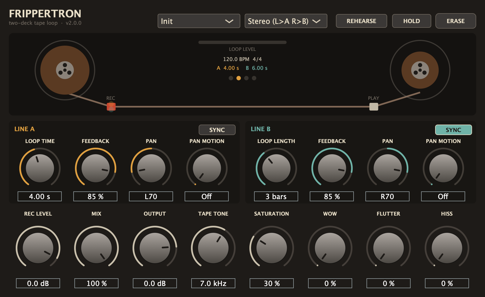

# Frippertron

Plugin d'effet (VST3 / AU / application autonome) pour macOS, qui reprend le principe des **Frippertronics** de Robert Fripp. Le dispositif d'origine relie deux magnétophones Revox par une même bande. La machine A enregistre. La machine B, placée à distance, relit la bande et renvoie le signal à l'entrée de A. Le son se superpose ainsi en couches qui s'effacent peu à peu.

Frippertron dispose de **deux lignes** de ce type (A et B). En mode **2 REVOX**, chacune a sa propre longueur de boucle : deux boucles de durées différentes se décalent sans cesse l'une par rapport à l'autre. En mode **1 REVOX**, B suit A : on retrouve la machine unique de Fripp, en stéréo.



**Télécharger :** [dernière version](https://github.com/elgaucholoco/Frippertron/releases/latest)

## Réglages

### Par ligne (A en ambre, B en vert)

| Réglage | Rôle |
|---|---|
| **Loop Time** (0,25–60 s) | Distance entre les deux machines. La changer en cours de jeu fait glisser la hauteur (effet varispeed). |
| **SYNC / Loop Length** | Cale la boucle sur le tempo du logiciel audio : de 1 temps à 16 mesures, selon le chiffrage. Au-delà de 60 s, la durée est divisée par deux jusqu'à rentrer. Un changement de tempo fait glisser la bande comme un varispeed. |
| **Feedback** | Niveau renvoyé de B vers A : vitesse d'effacement des couches anciennes. |
| **Pan** | Place de la ligne dans l'image stéréo. |
| **Pan Motion** | Pan automatique : la ligne fait l'aller-retour entre sa position et la position opposée, en 1 à 32 mesures (calé sur le tempo de l'hôte, ou 120 BPM s'il n'y en a pas). |

### Généraux

| Réglage | Rôle |
|---|---|
| **1 REVOX / 2 REVOX** | *1 REVOX* : la ligne B prend la durée, la synchro et la réinjection de A (ses réglages sont grisés) ; seuls son pan et son pan automatique restent libres, pour la largeur stéréo. *2 REVOX* : les deux lignes sont indépendantes. |
| **Routage** | *Stereo* : entrée gauche → A, droite → B. *Mono → A*, *Mono → B*, *Mono → A+B* : la somme des deux entrées va vers une ligne ou les deux. Avec une source mono, *Stereo* et *Mono → A+B* reviennent au même. |
| **Rec Level** | Niveau d'entrée enregistré sur la bande. |
| **Mix** | Dosage entre le signal direct et la bande. À 50 %, les deux sont à plein niveau. En départ d'effet (send), mettre 100 %. |
| **Output** | Volume de sortie. |
| **Tape Tone** | Perte d'aigus à chaque passage sur bande (filtre passe-bas 2 pôles, plus un passe-haut fixe à 35 Hz). |
| **Saturation** | Compression douce de la bande sur les crêtes. |
| **Wow / Flutter** | Instabilités de vitesse : wow lent (0,45 Hz) avec dérive aléatoire, flutter rapide (6,5 Hz). Chaque ligne a les siennes. |
| **Hiss** | Souffle de bande ajouté à chaque passage : il entre dans la boucle et s'accumule. |
| **REHEARSE** | On entend ce qu'on joue, mais rien n'est enregistré : pour chercher une phrase avant de la poser. La boucle continue de s'effacer normalement. |
| **HOLD** | Fige les boucles : l'entrée n'est plus enregistrée et la bande tourne sans aucune usure. |
| **ERASE** | Efface les deux bandes. Automatisable : on peut le déclencher en MIDI depuis le logiciel audio. |
| **Presets** | Init, Classic Revox, Two Revox Drift, Polymeter 4:5, Swirl, Worn Tape, Long Ambient. |

Le métronome visuel (un voyant par temps, le premier en rouge) suit le logiciel audio quand il joue.

## Compiler sur Mac

Prérequis :
- outils en ligne de commande Apple (`xcode-select --install`) ;
- CMake (`brew install cmake`, ou `pip3 install --user cmake`).

```bash
cmake -B build -DCMAKE_BUILD_TYPE=Release
cmake --build build --config Release -j8
```

JUCE 8.0.9 est téléchargé automatiquement au premier lancement de CMake. Après la compilation, le plugin est copié dans :
- `~/Library/Audio/Plug-Ins/VST3/Frippertron.vst3`
- `~/Library/Audio/Plug-Ins/Components/Frippertron.component` (AU)

Le binaire est universel (Apple Silicon et Intel), compatible macOS 11 et plus.

Si le plugin n'apparaît pas dans le logiciel audio, relance un scan des plugins. Il est rangé sous le fabricant **Carlos**. Pour Logic, valide l'AU avec `auval -v aufx Frpt Crls`.

### Tests

```bash
cmake -B build -DFRIPPERTRON_TESTS=ON
cmake --build build --config Release --target FrippertronTests
build/FrippertronTests_artefacts/Release/FrippertronTests
```

Les tests envoient des impulsions dans le plugin et vérifient où tombent les échos : routage, réinjection, REHEARSE, ERASE, HOLD, SYNC, pan automatique, stabilité à 100 % de réinjection, mode 1 REVOX, presets. `FrippertronTests --snapshot fichier.png [single]` enregistre une capture de l'interface (en mode 1 REVOX avec `single`).

## Architecture

- `Source/PluginProcessor.*` : traitement audio. Deux lignes, chacune avec un tampon circulaire mono de 60 s (la « bande ») lu avec interpolation d'Hermite. Chaîne de réinjection : passe-haut → passe-bas 2 pôles → saturation `tanh` → feedback, plus le souffle. HOLD et REHEARSE font des fondus de 50 ms ; HOLD recopie la bande à l'identique.
- `Source/PluginEditor.*` : interface avec deux bobines animées, têtes REC/PLAY, un point par ligne qui suit la position dans la boucle, l'indicateur de niveau, le tempo, le métronome, deux panneaux de ligne et les réglages généraux.
- `Tests/ProcessorTests.cpp` : tests hors ligne (cible optionnelle).

Historique des versions : [CHANGELOG.md](CHANGELOG.md).
